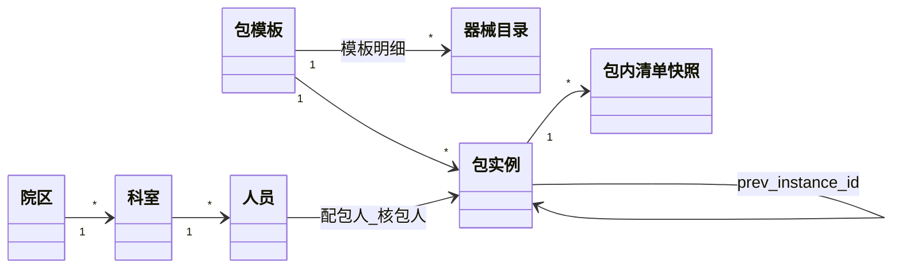
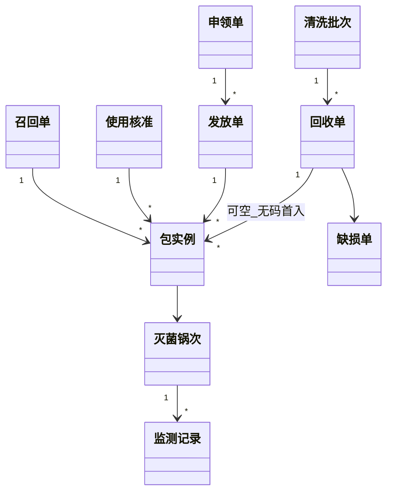
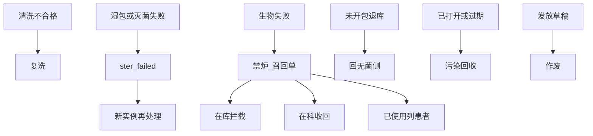

# 消毒供应追溯系统 · 需求详细设计说明书

> **本文档性质**：我方需求详细设计说明书，**开发唯一依据**。客户/厂商方案书有缺口和冲突，只作历史对照，**禁止**按其模块名、界面、标签尺寸实现。  
> **协作约定**：分流与编号遵循 [`docs/reusable-engineering-conventions.md`](./reusable-engineering-conventions.md) 第 0～1、7、9 节。  
> **流程**：合理性审查 → 写入本文 → 再开发 → 按交付清单自检。  
> **勿混放**：缺陷 ≠ 待确认 ≠ 待开发池。

**版本**：1.2（2026-09-09）· 文档自检：内部冲突已收口，缺口见 §1.20 / §6.4

**库表脚本**：[`docs/sql/pgsql/V1__cssd_tables.sql`](./sql/pgsql/V1__cssd_tables.sql)、[`docs/sql/pgsql/V2__cssd_indexes.sql`](./sql/pgsql/V2__cssd_indexes.sql)

**功能查阅**：第 7 章是编号索引；**第 10 章是开发实现用的功能详情**（入口、步骤、写库、校验）。第 1 章是强制规则。冲突时：**第 1 章 > 第 10 章 > 第 7 章索引表**。客户方案书只作历史对照，有缺口和冲突，**禁止按其界面、标签尺寸、模块名实现**。

---

## 0. 文档分流与编号

| 类型 | 本文位置 | 含义 |
|------|----------|------|
| 功能 / 业务需求 | [第 1 章](#1-功能业务需求)、[第 7 章](#7-全系统功能详细设计)、[第 10 章](#10-功能详情开发查阅) | 1 为规则；7 为索引；**10 为开发查阅的功能详情** |
| 缺陷 / 技术债 | [第 2 章](#2-已知问题-缺陷--技术债) | 已发现、要修 |
| 产品未决 | [第 3 章](#3-待确认问题) | 需业务方拍板 |
| 已认可但暂缓 | [第 4 章](#4-待开发功能池) | 值得做，暂无排期 |
| 协作 / 技术约定 | `reusable-engineering-conventions.md` | 怎么协作、怎么写代码 |
| 矛盾与缺口处理 | [第 6 章](#6-矛盾审查与缺口补齐) | 文档自检结论 |

**编号**：`{模块}-F/B/X/Q-{序号}`；暂缓 `BACKLOG-{模块}-{序号}`。

**模块代号**：`PKG` 包模板 · `INST` 单体器械 · `REC` 回收 · `WASH` 清洗 · `PACK` 配包核包 · `STER` 灭菌 · `MON` 监测 · `STORE` 无菌存放 · `DIST` 发放 · `USE` 申领/核准 · `TRACE` 追溯召回 · `ONCE` 一次性 · `EXT` 外来器械 · `LOAN` 寄消包 · `EQ` 设备 · `COST` 成本 · `NS` 护士长桌面 · `HIS` 接口 · `PDA` 手持 · `PRINT` 标签 · `MD` 主数据 · `SYS` 系统权限 · `RPT` 查询统计 · `DOC` 文档 · `UI` 前端 · `SCOPE` 范围 · `ARCH` 架构 · `REG` 法规

**状态**：`待处理` / `进行中` / `已完成` / `已关闭` / `搁置`

---

## 0.1 产品定位

医院消毒供应中心（CSSD）向全院提供无菌器械、敷料及一次性无菌用品。系统为目标对象建立唯一身份，记录质量数据，并关联使用患者与手术医师。

**法规基线**（设计按 WS 310-2009；若院方提供现行修订版，以院方文本替换细则，见 REG-Q-001）：

- WS 310.1 / 310.2 / 310.3
- 清洗、消毒监测资料留存 ≥ 6 个月；灭菌质量监测和记录留存 ≥ 3 年（系统**不按年限物理删**，只软删）
- 灭菌包外标识：物品名称、检查打包者姓名或编号、灭菌器编号、批次号、灭菌日期、失效日期
- 生物监测不合格：停止使用并召回上次合格以来灭菌物品；通知管理部门；已使用患者须可列出

---

## 0.2 已确认技术选型

| 项 | 结论 |
|----|------|
| 数据库 | **PostgreSQL**，schema `cssd`。建表 [`V1`](./sql/pgsql/V1__cssd_tables.sql) / [`V2`](./sql/pgsql/V2__cssd_indexes.sql) |
| 主键 | UUID7，`varchar(36)`，应用层生成 |
| 质量记录 | 禁止物理删除 |
| 统计口径 | JOIN 对象**当前**编码；快照分列仅对账 |
| 客户端 | **业务主路径在 Web**。污染区/清洁区/无菌区工位用 **Web 全屏页**（大按钮、适触屏），一期**不**做 Windows 原生触摸台安装包（BACKLOG-UI-001）。PDA 只做扫码便利补充，同一套接口与校验 |
| 标识 / RFID | 默认二维码。打印模板可配尺寸。**RFID 在 Web 打印时写入芯片并绑定**；条码始终可兜底 |
| 设备采集（一期） | 人工登记 + 报告/照片 URL；实时接口见 BACKLOG-EQ-001。装锅界面**不**采集实时参数 |
| HIS（一期） | 扫描把包**合到患者/就诊**；幂等；双方可互查对账。手工录入仍可用作兜底 |
| 包条码 | **每个灭菌循环新码，不复用**。器械本体条码循环复用。手术室「口护包 1–10」是上一循环实例，回收后配包必须新码 |
| 寄消 / 打包者 | **寄消人**与法规项「检查打包者」分列。常规包：**检查打包者 = 核包人**（无第三人「打包岗」）。寄消无核包时 = 建实例操作人 |
| 非植入高温放行 | **先按严格标准：等生物合格再放行**。一期装锅界面**不**提供「本锅关闭生物监测」。放宽只改 `cssd_sys_config` 且须另提需求 |
| 失效日期 | **灭菌完成日** + 实例 `shelf_life_days`。**禁止**按打印日计算 |
| 发放主路径 | **申领 → 发放**（可少发不可多发）。一期**不做**以收定发、借包窗口取货（BACKLOG-DIST-002） |
| 部署形态 | **一院一套私有化**。不做多家医院共享同一库的 SaaS。多院区用 `campus_id`。见 §1.17 |

---

## 0.3 一期范围裁定（消化 SCOPE 矛盾）

在第 3 章未另作否决前，按下列默认推进（可改，改则回写本章）：

| 纳入一期 | 不纳入一期 |
|----------|------------|
| CSSD 常规包、手术室包、寄消包、试验包（BD/PCD/生物） | 手术室**内部**清洗灭菌与手术室三级库（SCOPE-Q-001 → 否） |
| 外来器械：登记 → 洗消灭菌发放 → 术后厂家取走 | 贵重器械激光打码单体全流程（BACKLOG-INST-001） |
| CSSD **二级库**一次性：入库/发放/批次禁用 | 全院设备科一级库、门诊手术室覆盖（二期） |
| 中心手术室申领、下送接收、术前/术后核准、使用追溯 | 内镜洗消、区域 CSSD、成本核算、护士长大屏 |
| Web 工位全屏走完闭环 | Windows 原生触摸台、工位强制录像、以收定发/借包窗口、科室小程序红点 |

原方案曾写「第一阶段同步建立手术室内部清洗灭菌」，与「先保 CSSD+中心手术使用追溯」冲突：**本期只做后者**。

---

## 1. 功能 / 业务需求

| 编号 | 优先级 | 状态 | 提出 | 完成 | 摘要 | 验收要点 |
|------|--------|------|------|------|------|----------|
| DOC-F-001 | P3 | 已完成 | 2026-08-27 | 2026-08-27 | 迁入公共工程约定并建立本追踪文档 | 约定包 + Cursor rules + 分流齐全 |
| DOC-F-002 | P1 | 已完成 | 2026-08-27 | 2026-08-27 | 操作人/主数据快照分列 | 约定包 §6.9；见 §1.2 |
| DOC-F-004 | P1 | 已完成 | 2026-08-27 | 2026-08-27 | 本文升级为我方详细设计说明书（含第 7 章全功能） | 可替代并删除院方方案书 |
| DOC-F-005 | P0 | 已完成 | 2026-08-27 | 2026-08-27 | 正向/逆向闭环审核 + 领域对象图 + SaaS 裁定 | §1.14～§1.17；第 8、9 章 |
| DOC-F-006 | P1 | 已完成 | 2026-08-27 | 2026-08-27 | 建表与说明书对齐；单据冗余加强 | §1.8、§1.18；V1/V2 |
| DOC-F-007 | P0 | 已完成 | 2026-08-27 | 2026-08-27 | 第 10 章功能详情（开发查阅） | 每条一期功能含入口/步骤/写库/校验 |
| DOC-F-008 | P0 | 已完成 | 2026-09-09 | 2026-09-09 | 对照《功能逻辑基线》：吸收缺口；冲突已按建议执行 | §1.19.1 已落成硬裁定 |
| DOC-F-009 | P0 | 已完成 | 2026-09-09 | 2026-09-09 | 说明书内部冲突与业务缺口自检 | §1.20；第 6.4 节 |
| ARCH-F-001 | P0 | 已完成 | 2026-08-27 | 2026-08-27 | 数据库采用 PostgreSQL | schema `cssd`；V1/V2 脚本 |
| SCOPE-F-001 | P0 | 进行中 | 2026-08-27 | — | 一期闭环可追溯 | §0.3 + §1.3～§1.7 |
| PKG-F-001 | P0 | 待处理 | 2026-08-27 | — | 包模板档案 + 包内清单 + 流程开关 | 禁用不删；拼音检索 |
| MD-F-001 | P0 | 待处理 | 2026-08-27 | — | 院区/科室/人员/厂家/供应商/包装材料/篮筐/设备 | 编码唯一（未删）；拼音简码 |
| PACK-B-001 | P0 | 待处理 | 2026-08-27 | — | 配包提交创建实例并生成条码；核包通过后才可装锅 | 见 §1.14；与表结构一致 |
| PACK-B-002 | P0 | 待处理 | 2026-08-27 | — | 配包人与核包人不得为同一人 | 前后端均拦 |
| STER-B-001 | P0 | 待处理 | 2026-08-27 | — | 高温每日开炉前 BD 合格才允许该炉灭菌 | 见 §1.6 |
| STER-B-002 | P0 | 待处理 | 2026-08-27 | — | 每锅须 PCD；**高温/低温默认均须生物合格才放行**（含非植入） | 放宽走 `cssd_sys_config`，须另提需求 |
| PRINT-F-001 | P1 | 待处理 | 2026-08-27 | — | 可配置打印模板；过程签与法规签分阶段；RFID 写入 | §1.11、§1.14 |
| PDA-F-001 | P2 | 待处理 | 2026-08-27 | — | PDA 扫码便利（非主路径） | §1.9；与 Web 同接口 |
| HIS-F-001 | P0 | 待处理 | 2026-08-27 | — | 包合患者幂等 + 双方对账 | §1.10 |
| PACK-B-003 | P0 | 待处理 | 2026-08-27 | — | 包实例条码不复用；器械条码复用 | §1.12 |
| STER-B-003 | P0 | 待处理 | 2026-08-27 | — | 低温每锅生物监测合格才放行 | 见 §1.6 |
| DIST-B-001 | P0 | 待处理 | 2026-08-27 | — | 未放行、已过期、已召回、监测失败的包不得发放 | 见 §1.4 |
| USE-B-001 | P0 | 待处理 | 2026-08-27 | — | 术前核准拦截不合格/过期/禁用批次 | 关联患者+术者快照 |
| TRACE-B-001 | P0 | 待处理 | 2026-08-27 | — | 生物失败召回上次合格以来该灭菌器全部锅次包 | 列出已使用患者 |
| REC-B-001 | P1 | 待处理 | 2026-08-27 | — | 回收关联申领/发放；缺损单独登记 | 未回收逾期可查 |
| WASH-B-001 | P0 | 待处理 | 2026-08-27 | — | 清洗检测不合格不得进入配包 | 机洗可挂报告 URL |
| LOAN-B-001 | P1 | 待处理 | 2026-08-27 | — | 寄消包跳过回收清洗配包，灭菌后直发 | 清洁区建实例 |
| EXT-B-001 | P1 | 待处理 | 2026-08-27 | — | 外来器械术后厂家取走，不走回收 | 登记即关联手术/患者 |
| ONCE-F-001 | P1 | 待处理 | 2026-08-27 | — | 二级库批次入库发放与批次禁用 | 术前拦截禁用批 |
| REC-F-006 | P0 | 待处理 | 2026-09-09 | — | 回收明细作打散批次账本：总数/已配/剩余，允许部分配包 | 剩余 = qty − packed_qty；新实例挂来源回收单 |
| REC-F-007 | P1 | 待处理 | 2026-09-09 | — | 回收标记加急、污染、特殊感染 | 明细三列；加急可带到新实例 |
| BASKET-F-001 | P0 | 待处理 | 2026-09-09 | — | 筐状态机：空闲 / 待清洗 / 清洗中 | 无容量上限；一单多筐；出锅释放 |
| WASH-F-006 | P1 | 待处理 | 2026-09-09 | — | 清洗方式可临时覆盖并留痕 | 写 override 原因 |
| STER-F-007 | P0 | 待处理 | 2026-09-09 | — | 灭菌方式与设备类型不匹配禁止装锅 | 实例/模板 ster_method vs 设备 ster_temp_class |
| MON-F-005 | P0 | 待处理 | 2026-09-09 | — | 化学监测每锅人工登记 | monitor_kind=chem |
| PRINT-F-007 | P1 | 待处理 | 2026-09-09 | — | 发放单、申领单打印模板 | label_phase=dist_bill/apply_bill |
| DIST-B-002 | P0 | 待处理 | 2026-09-09 | — | 按申领发放：可少发不可多发 | 超申请数量拦截 |
| UI-F-001 | P0 | 待处理 | 2026-09-09 | — | 工位为 Web 全屏页，无 Win32 触摸台 | §1.9；原生包 BACKLOG-UI-001 |
| PACK-B-004 | P0 | 待处理 | 2026-09-09 | — | 无第三人打包岗；法规「检查打包者」= 核包人 | 过程签/法规签取 `checker_*` |

### 1.2 主数据快照（DOC-F-002，已定稿）

- 操作人：ID + 姓名，有工号写工号；变更记录同样。
- 单据头+明细强业务对象 **分列** 冗余编码、名称。
- 补充：规格/型号分列、锅号、包装有效期天数、住院号、当时床号等（约定包 §6.9.4）。
- 统计/筛选默认对象**当前**编码；快照只对账。界面可拼「编码 名称」，禁止拼列写回库。

### 1.3 领域模型：模板 vs 实例（补缺口）

方案写「每个消毒包完整清洗、配包、灭菌记录」，同时写 CSSD 常规包**打散清洗**。二者不能共用同一个「包条码从回收贯穿到发放」。

**裁定**：

| 对象 | 含义 | 何时有唯一条码 |
|------|------|----------------|
| **包模板** `cssd_pack_template` | 种类档案（名称、清单、包装、流程开关） | 无实例条码 |
| **包实例** `cssd_pack_instance` | 某一循环产生的具体无菌包 | **配包提交时诞生并生成条码**（§1.14） |
| **回收** | 关闭**上一循环**实例 | 扫的是旧条码 |
| **打散清洗** | 按篮筐/批次记录，不强制等于新实例 | 清洗批次号 |
| **整篮清洗**（手术室包） | 清洗明细可挂旧实例；配包后打**新包条码** | 器械码复用，包码不复用（§1.12） |

`prev_instance_id` 记录本循环与上一循环实例的衔接，便于「这个包上次谁用过」。

### 1.4 包实例状态机

字典 `pack_instance_status`（库内存码，界面中文）：

| 码 | 含义 | 主入口 |
|----|------|--------|
| `packed` | 已配包未核 | 配包提交 |
| `checked` | 已核包 | 核包 |
| `in_ster` | 已装锅未完成 | 灭菌装载 |
| `ster_done` | 灭菌结束待监测/放行 | 灭菌完成 |
| `released` | 监测放行 | 放行 |
| `stored` | 无菌库在库 | 入库（`need_store=1`） |
| `distributed` | 已发放未接收 | 发放 |
| `received` | 科室已接收 | 接收 |
| `pre_checked` | 术前已核准 | 术前核准 |
| `used` | 术后已核准 | 术后核准 |
| `recycled` | 已回收（实例结束） | 回收 |
| `vendor_taken` | 厂家取走 | 外来器械 |
| `expired` | 过期未用 | 过期作业 |
| `recalled` | 已召回 | 召回 |
| `ster_failed` | 灭菌/监测失败待处理 | 失败 |
| `voided` | 作废（未核包前） | 配包作废 |

**发放/术前硬拦截**：`need_store=1` 仅 `stored`（及之后在途态）可发放；`need_store=0` 可从 `released` 直发。之后：`distributed` / `received`。`packed`、`checked`、`in_ster`、`ster_done` 未放行不得发放。`expired`、`recalled`、`ster_failed`、`voided` 不得发放。法规包外签未打不得发放（§1.14）。过期看 `expire_date`，已发放告警并引导退回、寄消或回收。术前须已 `received`。

手术室包 `need_store=0`：放行后可直接发放，状态可跳过 `stored`。**`need_store=1` 的常规包：必须先入库（`stored`）才可发放**，仅 `released` 不得出库。寄消包：清洁区建实例；**寄消人**记 `loan_staff_*`，**检查打包者**记建实例操作人（必有，因提交即有操作人）。寄消用后若回 CSSD 再灭菌 → 走回收；不再回 CSSD → 实例在使用后结束，不强制 `recycled`。

过期：**发放/术前拦截以 `expire_date` 为准**，不依赖是否已改 `expired`。可将未用且过期的实例标为 `expired`（列表作业或日批），过期已发放仍按 REC-F-005 回收。

### 1.5 分类型流程开关

模板字段：`pack_category`、`need_wash`、`wash_mode`（`scatter` / `whole_basket`）、`need_pack`、`need_store`、`need_recycle`、`is_implant`。

| category | 清洗 | 配包核包 | 入库 | 回收 |
|----------|------|----------|------|------|
| `cssd_set` | 打散 | 要 | 要 | 要 |
| `or_set` | 整篮 | 要 | 否，直发 | 要 |
| `loan` | 否 | 否（科室换签） | 否，直发 | 视是否再使用 |
| `external` | 要 | 要 | 否，直发 | **否**（厂家取走） |
| `test_bd` / `test_pcd` / `test_bio` | 按院规 | 标识试验包 | 否 | 不发临床 |
| `once` | — | — | 二级库批次 | — |

清洗检测不合格：该篮/该批不得配包（WASH-B-001）。  
灭菌失败：实例 → `ster_failed`，不得放行；可重新清洗配包（新实例）。

### 1.6 监测与放行（STER/MON）

| 规则 | 说明 |
|------|------|
| 高温灭菌器 | **当日该炉**无合格 BD，禁止开始临床锅次 |
| 每锅 | 须装 PCD（批量监测包）；结果未出或失败 → 该锅 `release_status` 不得为 `released` |
| 植入物 / 低温 / **非植入高温（默认）** | 生物监测合格前禁止放行、禁止发放。一期装锅/灭菌界面**不得**给操作员「本锅不需生物」勾选。放宽只改 `ster.release.wait_bio`（管理员参数）并专门提需求 |
| 失效日期 | **灭菌完成日期** + 实例上快照的 `shelf_life_days`；灭菌完成后锁定。**禁止**按标签打印日计算。配包阶段可空或预估但不作放行依据 |
| 召回范围 | 生物失败：该炉**上次生物合格以来**全部已放行包。一期界面**不得**选「仅本锅」 |
| 参数存档 | `params_json` + `report_url`（一期手工上传）；**不做**设备实时采集（BACKLOG-EQ-001） |
| 化学监测 | 每锅须人工登记化学指示结果（`monitor_kind=chem`，回写锅次 `chem_result`）；不合格该锅不得放行，本锅实例 → `ster_failed`。**不**启动 §1.7 大范围召回（化学失败发生在放行前）。若误放行后再发现，按本锅已放行包召回，仍不是「上次生物合格以来」 |
| 物理监测 | 即灭菌结束填写的 `params_json` / 报告；参数明显不合格不得放行，处理同本锅失败，不按生物失败扩召回 |

锅次须记录：灭菌日期、灭菌器编号（`device_no`）、批次号（`load_no`）、主要装载、程序、主要参数、操作员、监测结果（WS 310 点名项）。

### 1.7 召回（TRACE-B-001）

生物监测不合格：

1. 该灭菌器停止使用；生成召回单（原因码 `bio_fail`）。
2. 召回范围：该设备**上次生物合格之后**（含失败锅）所有已放行实例。
3. 已发放：推送到科室并禁止术前使用；已使用：列出患者姓名/住院号快照，供院感观察（系统不替代临床随访）。
4. 灭菌器须再次生物合格后才允许新的临床锅次。

同厂家同批次一次性禁用：`cssd_once_lot.is_blocked=1`，发放与术前核准拦截。

### 1.8 对象与表（PostgreSQL）

Schema：`cssd`。主键 UUID7。主数据编码部分唯一索引（`is_deleted=0`）。明细冗余主表单号。

| 表 | 对象 |
|----|------|
| `cssd_dict` | 字典 |
| `cssd_campus` / `cssd_dept` / `cssd_staff` | 院区、科室、人员 |
| `cssd_vendor` / `cssd_manufacturer` | 供应商、厂家 |
| `cssd_pack_material` | 包装材料（含有效期天数） |
| `cssd_instrument` / `cssd_pack_template` / `_item` | 器械目录、包模板及明细 |
| `cssd_device` / `cssd_device_program` | 清洗机/灭菌器及程序 |
| `cssd_basket` / `cssd_cart` | 篮筐（含 `basket_status`）、下送车 |
| `cssd_once_item` / `cssd_once_lot` / `cssd_once_io` | 一次性品规、批次、出入库 |
| `cssd_pack_instance` / `_item` | 包实例及当时清单 |
| `cssd_recycle_bill` / `_item` | 回收 |
| `cssd_wash_batch` / `_item` | 清洗 |
| `cssd_ster_load` / `_item` | 灭菌锅次 |
| `cssd_monitor` | BD/PCD/生物/**化学** |
| `cssd_apply_bill` / `_item` | 申领 |
| `cssd_dist_bill` / `_item` | 发放接收 |
| `cssd_use_check` / `_item` | 术前术后核准 |
| `cssd_recall` / `_item` | 召回 |
| `cssd_defect` | 缺损 |
| `cssd_print_log` | 打印流水 |
| `cssd_entity_change_log` | 主数据变更 |

主数据变更精简快照白名单（代码须与此一致）：编码、名称、启用、包装有效期天数、流程开关、规格、型号、锅号、工号、所属科室。不含密码、不含拼音列亦可（拼音由名称生成）。

单号前缀（§6.8，可调）：`HS` 回收 · `QX` 清洗 · `MJ` 灭菌锅次 · `JC` 监测 · `SL` 申领 · `FF` 发放 · `HZ` 核准 · `ZH` 召回 · `QS` 缺损 · `YC` 一次性出入库。

另增：`cssd_print_template` 打印模板 · `cssd_rfid_bind_log` 绑卡流水 · `cssd_his_sync_log` HIS 幂等流水 · `cssd_sys_config` 院内参数。

**无独立单据的环节（避免开发再造表）**：无菌入库、放行、过程签/法规签打印——写在 `cssd_pack_instance`（`stored_at` / `released_at` / `legal_printed_at` 等），流水进 `cssd_print_log`。配包没有头表，配包提交即 INSERT 实例。

列注释已写在 V1。本轮相对 0.8 补齐的冗余见 §1.18。

### 1.9 Web 主路径与 PDA 补充

**裁定：主要业务操作在 Web。** PDA 不是第二套系统，只为扫码、走动岗位提供便利，调用与 Web 相同的后端校验（放行、双人核包、幂等、软删）。无 PDA 时，Web 必须能独立完成一期闭环。

**工位形态（UI-F-001，已按冲突建议执行）**：回收、清洗、配包、核包、灭菌、发放等现场工位做成 **Web 全屏页**（大按钮、适触屏一体机浏览器）。一期**禁止**交付 Windows 原生触摸台安装包、禁止要求「必须是安装软件不是 Web」。原生包见 BACKLOG-UI-001。科室端一期走 Web 申领/待办，**不做**小程序实时红点（BACKLOG-UI-002）。工位**不强制录像**（BACKLOG-MEDIA-001）。

| 能力 | Web（主） | PDA（补充，可选） |
|------|-----------|-------------------|
| 主数据、打印模板、参数、权限、报表、召回单、对账 | 全部 | 不提供维护；可只读查包 |
| 回收、清洗、配包核包、灭菌装载、入库、发放接收、申领、术前术后核准 | **完整表单与列表** | 扫码加速同一动作（选单、确认） |
| 标签打印 + RFID 写入 | **主入口**（§1.11） | 不作为绑卡主入口；至多补打查询 |
| 离线 | 不依赖 | 可选本地队列（约定包 §8.1） |

岗位登录、分区授权、失败/召回拦截在两端一致。PDA 未覆盖的步骤一律在 Web 完成。

### 1.10 HIS 一期（扫描合患者 + 幂等 + 互查）

**目标**：术前核准把无菌包**合到具体患者/就诊**；同一包同一就诊只入账一次；CSSD 与 HIS **都能查到对方关键状态**，避免「HIS 有使用、追溯无患者」或反过来。

| 方向 | 内容 | 幂等键建议 |
|------|------|------------|
| HIS → CSSD | 患者主索引、就诊/手术 ID、住院号、床号、术者、科室；可选手术申请单 | `his_patient_id` + `his_encounter_id` |
| CSSD → HIS | 包条码、模板、灭菌批次、放行/过期/召回状态、合患者时间 | `barcode` + `his_encounter_id` + `biz_type` |
| 互查 | CSSD 按住院号/就诊查包；HIS 按条码查灭菌与使用 | 查询接口，不写库 |

**写库规则**：`cssd_his_sync_log.idempotency_key` 唯一。核准提交用 `cssd_use_check.idempotency_key`。重复请求返回已成功结果，不插第二笔使用。合患者失败允许手工录住院号（快照仍要写）。

**经验上建议同期做、避免单边账的项**（一期最小集）：

1. 科室、人员工号对照（至少术者、手术室）。  
2. 就诊/手术标识，不要只用姓名。  
3. 对账任务：每日「已核准有 HIS 键 vs HIS 已计费/已登记手术」差集。  
4. 召回时把已合患者清单推给院感/HIS（只读名单即可）。  

**可暂缓**（BACKLOG-HIS-001）：收费、物资一级库、自动申领、财务结算、字典全量定时同步。

### 1.11 打印模板与 RFID（Web 打印时写入）

- 标签尺寸不写死：`cssd_print_template` 配纸宽/纸高/版式。法规必打项（包名、**检查打包者**、灭菌器编号、批次号、灭菌日、失效日）在**法规包外签**模板中勾选，缺项不得启用该模板。  
- **检查打包者**：常规包取核包人 `checker_id/no/name`（PACK-B-004）。配包人 `packer_*` 可另打在过程签，**不**替代法规项，也**不**再设第三人「打包岗」。寄消无核包时取建实例操作人。  
- 单据打印：`label_phase` 另支持 `dist_bill`（发放单）、`apply_bill`（申领单）。基线「借包单」= 申领单，**不**建 `t_borrow_order` / 借包审核工位。  
- **两阶段打印**（§1.14）：核包阶段打**过程签**（身份条码，灭菌日可空）；灭菌完成并算出失效日后打**法规包外签**。RFID 在 **Web 打印**时写入（过程签或法规签均可，同一 UID，禁止静默改绑）。  
- 写入失败：打印二维码仍可成功，实例可无 RFID 继续流转；失败原因进流水，允许 Web 重打重写。改绑/重写必须有权限。条码始终兜底。PDA 不做绑卡主入口。  

### 1.12 包条码不复用、器械条码复用

**同意：包码不要复用。**

| 码 | 是否复用 | 原因 |
|----|----------|------|
| **包实例条码** | 否。每一灭菌循环新码 | 包码若复用：未软删的旧实例与新循环**唯一约束撞车**；已结束的旧实例若允许同码，扫码会命中多行，患者/锅次/失效日会串；召回按码会把历史锅次搅在一起。`prev_instance_id` 已能串起「这套器械上一包」 |
| **器械本体条码** | 是。物理件终身一码 | 器械反复清洗打包，码在 `cssd_instrument.barcode`；包内清单只**快照**编码名称规格，并挂 `instrument_id` |

手术室整篮清洗也不复用包码。旧包回收后旧码只用于追溯历史，新无菌包必须新码。

**对基线「口护包 1–10 永久一码」的执行**：模板种类只有「口护包」一种。现场同时流转的 10 个无菌包是 **10 个实例、10 个当前条码**。回收扫到的是上一循环旧码（例如当时叫口护包3）；配包提交后该物理内容对应**新实例新码**，用 `prev_instance_id` 串历史。禁止为「好记」把旧码写回新实例。

### 1.13 数据库

PostgreSQL，schema `cssd`。主键 UUID7（`varchar(36)`）。时间用 `timestamptz`；灭菌参数、打印版式用 `jsonb`。脚本：`docs/sql/pgsql/V1__cssd_tables.sql`、`V2__cssd_indexes.sql`。

### 1.14 正向闭环裁定（本轮审核）

闭环：**（发放侧）申领 → 发放**；**（再处理侧）回收（不强制先有申领；新器械无码入洗）→ 清洗（检测合格）→ 配包 → 核包 → 装锅 → 灭菌完成 → 监测齐套 → 放行 →（入库）→ 发放 → 接收 → 术前核准合患者 →（术后核准）→ 再回收。**  
「申领可后补」**只**表示回收/首次入洗不要求先有申领，**不是**允许无申领发放。常规包、手术室包发放必须挂已提交申领。寄消、外来、试验包不走申领库存（直发/不发临床）。

| 曾冲突/缺口 | 裁定（开发按此实现） |
|-------------|----------------------|
| 实例诞生点 | 文案曾写「核包后诞生」，表结构是配包后即有条码。**以表为准：配包提交 INSERT 实例**（`packed`，条码已生成，清单快照已写）。核包通过 → `checked`，配包人≠核包人。**无独立打包工位、无第三人打包人**。未核包不得装锅。作废仅允许 `packed` |
| 法规标签时机 | 核包时灭菌日/锅号/失效日尚不存在，不能一次打齐 WS 310 包外标识。**过程签**（核包，身份码）：包名、配包人、**检查打包者=核包人**、条码；灭菌日可空。**法规包外签**（灭菌完成锁定 `expire_date` 之后、放行之前或同时）：补打灭菌器编号、批次号、灭菌日、失效日。失效日按灭菌完成日计算，**禁止按打印日**。未打法规签不得发放 |
| 术前 / 术后 | **术前核准强制**（合患者）。术后清点一期要有功能；**回收不依赖术后是否做完**（现场常漏做，不能卡死回收） |
| 新器械首次 | 回收明细 `instance_id` / `barcode` **允许为空**，按模板编码+数量入洗；本循环配包才产生新实例 |
| 申领与发放 | **主路径是申领 → 发放**，不是以收定发。申领：`draft` → `submitted` → `partial` / `closed` / `voided`。已提交可部分发放，可少不可多；全部明细 `dist_qty` 达到申请量后关单 `closed`。草稿可作废（软删）。已发放明细禁止物理删。一期**不做**借包窗口取货、待发放=回收数−还包数。寄消/外来/试验不走申领 |
| 装锅改锅 | 锅次 `draft` 可增删包；**灭菌开始后锁定明细**。试验包（BD/PCD/生物）入锅但不发临床 |
| 一次性 | 走批次表，不走包实例状态机。术前若带一次性，校验批次未禁用、未过期 |
| 登录账号 | `cssd_staff` 是业务人员；登录/密码/角色由开发所选框架实现，须能按工号对应到 `staff`，并按污染区/清洁区/无菌区/科室授权 |

正向状态允许跳过：`need_store=0` 跳过 `stored`；寄消 `need_wash=0` 且 `need_pack=0` 时清洁区直接建 `checked` 实例再装锅。

### 1.15 逆向与异常（本轮补齐）

下列均为**一期要做**，不是 BACKLOG。失败后产生的新无菌包必须是**新实例、新条码**。

| 编号 | 场景 | 处理 |
|------|------|------|
| WASH-F-005 | 清洗检测不合格 | 该篮/批锁定，不得配包；允许**复洗**（新清洗批次或同批重开，记检测史）。禁止把不合格批改成合格而不留痕迹 |
| STER-F-005 | 湿包、包破、装载错误（灭菌结束后外观不合格） | 实例 → `ster_failed`，该包不得放行；可随锅次其他包分别处理。该包重新清洗配包（新实例，`prev_instance_id` 指向失败包） |
| STER-F-006 | 灭菌未开始发现错装 | 从锅次明细移除，实例退回 `checked`，可改锅 |
| STER-F-004 | PCD/生物失败 | §1.7 召回 + 禁炉；范围内已放行包 → `recalled`。化学/物理失败见 §1.6：只拦本锅，不扩召回 |
| TRACE-F-005 | 召回执行 | 在库：不得发放；在科：通知收回，科室扫码确认退回污染区；已使用：只列患者供院感，不改临床病历。收回后旧实例保持 `recalled`，器械进入再处理 |
| DIST-F-005 | 未开包退库 | 已接收、未术前核准、未过期、包装完好：可退回无菌库（`stored` 或 `released` 视是否入库）。已打开或已术前核准：只能当污染回收，不得退无菌库 |
| DIST-F-006 | 发放单作废 | 仅尚未出库（`draft`）可作废；已出库只能退库或回收 |
| USE-F-006 | 合患者纠错 | 高权限更正住院号/术者，写变更记录；须保留原快照痕迹（变更日志），禁止无痕改患者 |
| REC-F-005 | 过期已发放 | 告警；引导退回后按污染回收或寄消再灭菌；不得继续术前使用 |
| ONCE-F-005 | 批次事后禁用 | 已发放未用：拦截术前；已用：列入观察名单（同召回已使用逻辑，不强制改历史发放行） |

配包作废、回收归属调整、灭菌失败再配：已有 PACK-F-003 / REC-F-004 / §1.5，保持不变。

### 1.16 单据头状态（开发须实现）

| 单据 | 状态码 | 说明 |
|------|--------|------|
| 回收 / 清洗 / 灭菌锅次 / 监测 / 申领 / 发放 / 核准 / 召回 | 至少含 `draft`、提交后业务态、`voided`（仅草稿或未产生质量后果时） | 已提交的质量明细禁止物理删 |
| 灭菌锅次 `load_status` | `draft` → `running` → `finished` | 与实例 `in_ster` / `ster_done` 同步 |
| 锅次 `release_status` | `pending` / `released` / `rejected` | 放行写实例 `released` |

### 1.17 部署形态与 SaaS（已裁定）

**一期没有做多医院 SaaS 的必要。** 本系统绑院内 HIS、患者身份、灭菌质量记录（留存 ≥3 年、禁止物理删）。多家医院共享同一套库、用 `tenant_id` 行级隔离，会把院感数据和 HIS 对账搅在一起，实施成本和合规风险都高于收益。

| 做法 | 一期 |
|------|------|
| 一所医院一套部署、一套 PostgreSQL、schema `cssd` | **要** |
| 同一医院多个院区 | **要**：已有 `cssd_campus`，科室挂院区 |
| 医院名、HIS 地址、放行策略 | **要**进 `cssd_sys_config`，禁止写死在代码 |
| 多家医院共用一库一行级租户 | **不要**。将来区域 CSSD / 云上多院：一院一库（或一院一 schema），见 BACKLOG-REGIONAL-001 |
| 框架里预留 tenant 字段「以防万一」 | **不要**。无客户却给每张表加租户列，会干扰本期核对 |

开发选框架时按**单院单体/模块化均可**；不要按多租户 SaaS 脚手架生成权限和库隔离，以免与本文表结构对不上。

### 1.18 建表与说明书对齐、冗余加强（0.9）

对照 V1 后关闭的出入：

| 出入 | 处理 |
|------|------|
| 文案「核包诞生实例」vs 表有条码 | 已按 §1.14：配包提交诞生 |
| 法规签无落点，无法拦截未打签发放 | 实例增 `process_printed_at`、`legal_printed_at`；打印模板/流水增 `label_phase` |
| 无菌入库、放行无单据表 | **不新建表**；实例增入库/放行人及时间 |
| WS 310「主要装载」无列 | 锅次增 `main_load_desc` |
| 回收未挂发放明细 | 回收明细增 `dist_bill_*` / `dist_item_id` |
| 器械码「终身一码」无唯一约束 | V2：`barcode` 未删且非空时唯一 |

本轮在**单据头/明细**加强的快照（约定包 §6.9，分列、不拼接）：

- 有科室的单据：同时记当时 **院区** id/code/name（申领、发放、回收、核准、实例所在位置、召回明细）
- 发放/核准/装载明细：灭菌日、失效日、锅号（及发放明细的批次号），列表对账少 JOIN
- 召回明细：模板编码名称、床号、术者
- 一次性批次/出入库：供应商；出入库再摊灭菌批号、效期
- 设备程序、包模板明细、RFID/HIS 流水：缺的名称或锅号补上
- 实例：模板流程开关与所属科室当时值（日后改模板不影响在途包）

**未摊到主数据表**：科室上的院区、人员上的科室、器械上的所属科室仍只存 ID，展示 JOIN 当前值（这些不是业务单据）。

拦截：`legal_printed_at` 为空不得发放（与 §1.14 法规签一致）。

### 1.19 对照《功能逻辑基线》（1.1，DOC-F-008）

对照源：[`docs/需求规格说明书重新学习-功能逻辑基线.md`](./需求规格说明书重新学习-功能逻辑基线.md)（来自厂商「全自动化三端」规格书）。**不是**开发依据。该文假设 Windows **原生**触摸台 + Android APK + Web 后台、工位强制录像、以收定发/借包窗口取货。与我方 **Web 主路径、申领→发放、一院一套** 不是同一产品，禁止整份照搬表名、工位名、界面。

#### 1.19.1 冲突：已按建议执行（2026-09-09）

下列不再是「待选」，开发按「执行」列实现。

| 基线说法 | 执行（已写入 §0.2 / §1.6 / §1.9 / §1.11 / §1.12 / §1.14） |
|----------|------|
| Windows 触摸台必须是安装软件 | **Web 全屏工位**（UI-F-001）。原生 Win32 → BACKLOG-UI-001 |
| 配包台 + 打包台 + 强制录像 | **无第三人打包岗**。法规「检查打包者」= 核包人。录像 → BACKLOG-MEDIA-001 |
| 手术室永久一包一码（口护包 1–10） | **每循环新码**。1–10 是上一实例，见 §1.12 |
| 失效日 = 打印日 + 包材天数 | **灭菌完成日** + `shelf_life_days`。禁止按打印日 |
| 生物可关；召回可仅本锅 | **默认全锅等生物**。装锅界面无关闭勾选；召回上次合格以来。放宽须另提需求 |
| 以收定发；借包窗口取货 | **申领 → 发放**。以收定发 → BACKLOG-DIST-002 |
| 设备实时参数进锅次 | 一期人工 + URL。BACKLOG-EQ-001 |
| 表名 `t_package` 等 | **不改**，只用 `cssd_*` |
| 科室小程序实时红点 | 一期 CSSD 待办列表。小程序 → BACKLOG-UI-002 |

#### 1.19.2 本轮吸收（已写入第 7、10 章与 V1）

1. **筐状态机**：`idle` / `pending_wash` / `washing`。无容量上限；一回收单可多筐；可部分入清洗锅；出锅释放为空闲。参数 `basket.allow_remove`：已入筐是否允许移出。
2. **临床打散批次账本**：回收明细当批次。`qty` 总数、`packed_qty` 已配、剩余 = 差。允许部分配包。新实例挂 `recycle_bill_id` / `recycle_item_id`。
3. 回收标记：加急、污染、特殊感染。
4. 装锅：实例/模板 `ster_method` 与设备 `ster_temp_class` 不一致则禁止。
5. **化学监测**每锅人工登记（`monitor_kind=chem`）。
6. 清洗方式可临时覆盖并写原因。
7. 发放单 / 申领单打印模板。
8. 配包图谱 `image_url`、核包图谱 `check_image_url`。
9. PDA：业务时间写单据上的操作时间（如 `recyc_at`）；`created_at` 视为上传/落库时间。
10. 默认岗位：管理员 / 护士长 / 操作员 / 下送 / 临床（菜单授权，不另建租户）。
11. 申领发放：**可少发不可多发**。设备「空闲」由进行中清洗批/灭菌锅推导，不另维护占用表。

#### 1.19.3 基线内部须知（给评审）

第七节写「灭菌合格后以灭菌时间为基准加包材天数」；第十八节又写「打印日期加包材天数、灭菌时间按打印日」。**只采纳第七节**，与我方 §1.6 一致。第十八节「手术室永久一包一码」与「每循环新码」冲突，按 §1.12。

### 1.20 说明书内部自检收口（1.2，DOC-F-009）

对照第 1、7、10 章与 V1 后，下列原文打架或闭环缺口**已裁定**（开发按此，勿再按旧句）：

| 原文打架 / 缺口 | 收口 |
|-----------------|------|
| §1.14「申领可后补」vs DIST-F-001 必须按申领发放 | **回收/无码入洗不强制申领**；**发放必须挂已提交申领**。寄消/外来/试验例外 |
| §1.4 寄消打包者「可空」vs §0.2「检查打包者=操作人」 | **检查打包者=建实例操作人，必填**；寄消人仍另列必填。第 7 章 LOAN 旧句作废 |
| 第 5 章「未打码才可作废」vs PACK-F-003 配包提交已有条码 | **`packed`（已有条码、未核）可作废**；已核/已装锅不可 |
| §1.4 发放允许 `released` vs 常规包要入库 | **`need_store=1` 必须 `stored` 才发放**；`need_store=0` 可从 `released` 直发 |
| `expired` 有状态无作业 | 拦截看 **`expire_date`**；标 `expired` 是可选作业，不是拦截前提 |
| 化学失败写「按湿包」易理解成单包外观 | **化学不合格整锅不放行**，本锅实例 `ster_failed`；**不**走生物大范围召回 |
| 打散配包如何证明已清洗 | 来源回收明细必须出现在 **检测合格** 的清洗批 `wash_item` 上 |
| 核包只有「通过」 | **不通过**：保持 `packed`，写原因，可再核；也可作废。不写 `checker_*` 直到通过 |
| 术前是否必须已接收 | **必须 `received`**（直发未走下送的，发放确认时一并视为接收或先点接收） |
| 锅次 `release_status` 文案 rejected vs 注释 blocked | 统一 **`pending` / `released` / `rejected`** |
| 安全库存无列 | 模板增 `safety_stock_qty`；空则用参数 |
| HIS-F-001 与 HIS-F-002 两个编号 | **同一功能**；实现看第 10 章 HIS-F-002（即第 1 章 HIS-F-001） |
| PRINT-F-001 与 PRINT-F-002 | 001 是规则总包；**实现看 PRINT-F-002～007** |
| 清洗批「进行中」无状态 | `batch_status`：`draft` → `running` → `finished`（EQ-F-003 认 `running`） |
| 召回「通知管理部门」无流程 | 一期以召回单+已使用患者列表为落点，不接 OA |

**未收口、不挡一期开发**：ARCH-Q-001（后端语言、PDA H5/原生）；REG-Q-001（院方 WS 310 修订版文本）。

---

## 2. 已知问题（缺陷 / 技术债）

| 编号 | 优先级 | 状态 | 提出 | 摘要 | 说明 |
|------|--------|------|------|------|------|
| DOC-X-001 | P2 | 已关闭 | 2026-08-27 | 需求大纲与待确认、建议书分期互相打架 | 第 6 章已消化；按 §0.3 执行 |

---

## 3. 待确认问题

| 编号 | 状态 | 提出 | 问题 | 影响 |
|------|------|------|------|------|
| ARCH-Q-001 | 部分确认 | 2026-08-27 | Web 主路径、PDA 补充、PostgreSQL 已定。后端语言、PDA 用 H5 还是原生仍待定（开发自选） | 工程骨架 |
| ARCH-Q-004 | 已关闭 | 2026-09-09 | 工位是否必须 Windows 原生触摸台 | **否**。工位用 Web 全屏即可，见 §1.19；原生安装包 BACKLOG-UI-001 |
| ARCH-Q-003 | 已关闭 | 2026-08-27 | 是否一期按 SaaS 多租户设计 | **否**，§1.17 |
| ARCH-Q-002 | 已关闭 | 2026-08-27 | 一期设备接口 | 已裁定人工+URL |
| HIS-Q-001 | 已关闭 | 2026-08-27 | HIS 一期范围 | 见 §1.10 |
| PRINT-Q-001 | 已关闭 | 2026-08-27 | 标签尺寸 / RFID | 模板可配；**Web 打印时写入 RFID** §1.11 |
| PACK-Q-001 | 已关闭 | 2026-08-27 | 包码是否复用 | 包码不复用；器械码复用 §1.12 |
| LOAN-Q-001 | 已关闭 | 2026-08-27 | 寄消标签打包者 | 寄消人 + 检查打包者分列；常规包打包者=核包人 |
| STER-Q-001 | 已关闭 | 2026-08-27 | 非植入高温是否等生物 | 默认严格等；放宽另提需求 |
| SCOPE-Q-001 | 已关闭 | 2026-08-27 | 手术室内部洗消是否一期 | 否，见 §0.3 |
| SCOPE-Q-002 | 已关闭 | 2026-08-27 | 包类型是否全进一期 | 见 §0.3 |
| REG-Q-001 | 待确认 | 2026-08-27 | 院方是否提供 WS 310 现行修订版 | 监测细则 |

---

## 4. 待开发功能池

| 编号 | 来源 | 摘要 | 暂缓原因 |
|------|------|------|----------|
| BACKLOG-ENDO-001 | 原方案转化 | 内镜洗消中心 | 非一期闭环 |
| BACKLOG-REGIONAL-001 | 原方案转化 | 区域消毒供应中心 | 运营未定 |
| BACKLOG-COST-001 | 原方案转化 | 成本核算与缺损补偿结算 | 主流程未稳 |
| BACKLOG-NS-001 | 原方案转化 | 护士长主题分析桌面 | 有数据后再做；过期/未回收告警一期用列表即可 |
| BACKLOG-ONCE-002 | 原方案转化（其二期） | 全院一次性 + 设备科一级库 | §0.3 |
| BACKLOG-EQ-001 | 原方案转化 | 清洗/灭菌设备实时采集与控制 | 一期 URL |
| BACKLOG-INST-001 | 原方案转化 | 贵重器械表面打码单体追溯 | 复杂度高 |
| BACKLOG-OR-001 | 原方案转化 | 手术室内部洗消 + 三级库 | §0.3 |
| BACKLOG-HIS-001 | 原方案转化 | 收费/一级库/自动申领/财务/全量字典同步 | 一期只做合患者+对账 |
| BACKLOG-SYS-001 | 原方案转化 | 终端仅允许运行本系统（kiosk/桌面锁定） | 非闭环；由信息科策略或二期 |
| BACKLOG-HR-001 | 原方案转化 | 内部排班、绩效考评 | 非闭环 |
| BACKLOG-MEDIA-001 | 对照基线 | 工位强制录像及视频归档表 | 非闭环；存储与隐私成本高 |
| BACKLOG-UI-001 | 对照基线 | Windows 原生触摸台安装包 | 一期 Web 工位全屏即可 |
| BACKLOG-UI-002 | 对照基线 | 科室小程序 / 实时红点弹窗 | 一期 CSSD 待办列表 |
| BACKLOG-DIST-002 | 对照基线 | 以收定发 + 借包窗口取货（与申领并行） | 与申领→发放主路径冲突，须产品拍板后才进一期 |
| BACKLOG-LOCK-001 | 对照基线 | 工位并发锁 UI（如 120 秒） | 一期靠后端校验即可；锁屏交互二期 |
| BACKLOG-RPT-001 | 对照基线 | 工作量图表 / 独立追溯事件表 | 一期用操作人+单据时间查询 |

---

## 5. 协作附录

- 工程约定：[`docs/reusable-engineering-conventions.md`](./reusable-engineering-conventions.md)
- 质量记录禁止物理删除；**已提交的配包/灭菌/监测/发放明细同样禁止物理删**。配包提交后即有条码：仅 `packed`（未核）可作废（`voided` + 软删），对应建议书「配包调整删除」。已核包不可作废。
- 新表 UUID7；明细冗余单号；操作人姓名/工号；主数据编码名称分列。
- 途径：`web` / `app`（PDA）。
- 执行脚本：`V1__cssd_tables.sql`（含列注释）→ `V2__cssd_indexes.sql`。

---

## 6. 矛盾审查与缺口补齐

### 6.1 已消化的矛盾

| 点 | 原文冲突 | 处理 |
|----|----------|------|
| 一期范围 | 1.1 罗列全部包类型 vs Q 未决 vs 二期一次性 | **§0.3 裁定表** |
| 手术室内部洗消 | 建议书一期含 vs 风险过大 | **一期不做** |
| 包级清洗记录 | 「每包清洗记录」vs 打散清洗 | **§1.3 模板/实例/清洗批次分离** |
| 配包删除 | 建议书可删未核包 vs 质量禁止物理删 | **作废+软删** |
| 统计键 | 曾写按快照编码统计 vs 后改当前编码 | **当前编码**（§1.2） |
| 展示 | 快照名 vs 当前名 | 对象展示当前；操作人展示当时姓名 |
| 「删除不能删」vs 软删 | 建议书不能删除 | 软删对用户即不可删；库内保留 |
| 客户端 | 方案书偏手持主采集 vs 现场主操作 | **Web 主路径，PDA 便利补充**（§1.9） |
| 触摸台必须 Win32 | 基线强制安装包 vs 我方 Web | **已执行：Web 工位全屏**（UI-F-001）；原生包 BACKLOG-UI-001 |
| 失效日锚点 | 基线 §十八打印日 vs 第七节灭菌完成日 | **已执行：灭菌完成日**（§1.6）；禁止按打印日 |
| 发放主路径 | 以收定发/借包窗口 vs 申领发放 | **已执行：申领为主**；以收定发 BACKLOG-DIST-002 |
| 包码 | 手术室永久一码 vs 每循环新码 | **已执行：每循环新码**（§1.12） |
| 打包岗 | 基线配包+打包两岗 vs 双人核包 | **已执行：检查打包者=核包人**，无第三人 |
| RFID | 独立绑卡页 vs 打印写入 | **Web 打印时写入**（§1.11） |
| 实例诞生 | 「核包诞生」vs 表「配包后有条码」 | **配包提交诞生**（§1.14） |
| 包外法规项 | 核包即打灭菌日 vs 灭菌后才有日期 | **过程签 + 法规签**（§1.14） |
| SaaS | 初期多租户 vs 单院 HIS | **一院一套，不行级租户**（§1.17） |

### 6.2 已补的业务缺口

- 包实例诞生点、状态机、放行拦截
- 配包≠核包、失效日期锚点、植入物/低温/BD/PCD 约束
- 召回范围与已使用患者清单
- 寄消/外来/试验包路径
- 清洗不合格、灭菌失败再处理
- 过期包、禁用一次性批次
- HIS 未接通时的手工患者/术者
- 打印流水、变更记录表
- 申领→发放→回收数量勾稽（明细留 `dist_qty` / `recycle_qty`）
- 第 7 章全系统功能说明书（可替代并删除院方方案书）
- 过程签 vs 法规签、配包诞生实例、逆向湿包/退库/复洗/召回收回（§1.14～§1.15）
- 单院部署、不做行级 SaaS（§1.17）
- 建表与说明书对齐、单据冗余加强（§1.18）
- 第 10 章功能详情（以本文规则为准，不以客户方案书为准）
- 对照《功能逻辑基线》：筐状态、打散批次剩余、化学监测、装锅方式校验等（§1.19.2）
- 文档内部冲突收口：申领与发放边界、入库后发放、化学失败不扩召回、核包不通过、术前须接收等（§1.20）

### 6.3 仍开放

仅余：后端语言与 PDA 原生/H5（ARCH-Q-001，交给开发选型）；院方 WS 310 修订版文本（REG-Q-001，不挡一期按 2009 设计）。建表出入已在 §1.18 关闭。与基线的产品形态冲突已在 §1.19.1 **按建议执行并关闭**。说明书内部打架已在 §1.20 关闭。以收定发是否二期见 BACKLOG-DIST-002。

### 6.4 本轮自检说明（DOC-F-009）

自检范围：本文第 0～10 章是否自相矛盾、闭环是否可走通。对照源（客户方案书、功能逻辑基线）不再重复展开。

**已改掉的内部冲突**见 §1.20 表。开发若发现第 7 章索引与第 10 章细节不一致，以第 1 章 + 第 10 章为准。

**仍非缺口、刻意不做的**：Win32 触摸台、录像、以收定发、设备实时采集、费用、多租户。不要当成遗漏补回一期。

---

## 7. 全系统功能详细设计

下列为**功能编号索引**。一期要做的写「一期」。**具体怎么做见第 10 章同编号**。界面按 Web 主路径。与第 1 章冲突时以第 1 章为准。客户方案书不作为实现依据。

### 7.1 登录、权限与系统（SYS / UI）

| 编号 | 期 | 功能 | 说明 |
|------|----|------|------|
| SYS-F-001 | 一期 | 工号/账号登录、按岗位授权 | 污染区/清洁区/无菌区/科室菜单不同；无权限显示「—」 |
| SYS-F-002 | 一期 | 操作途径 | 写 `create_channel` 等：`web` / `app` |
| SYS-F-003 | 一期 | 字典中文 | 状态/分类存码，界面中文；新枚举同期种子 |
| SYS-F-004 | 一期 | 系统参数 | `cssd_sys_config`：过期提前天数、生物放行策略（仅管理员，操作员装锅不可关）、`basket.allow_remove` 等 |
| SYS-F-005 | 一期 | 变更记录 | 主数据改码改名改启用写 `cssd_entity_change_log` |
| SYS-F-006 | 一期 | 拼音检索 | 包/器械/科室/人员/设备：编码 OR 名称 OR 简码 |
| SYS-F-007 | 一期 | 操作审计 | 质量相关写操作可追溯到人、时间、途径；记录禁止物理删 |
| SYS-F-008 | 暂缓 | 终端桌面锁定（仅授权应用） | 方案书「桌面安全组件」；非闭环必要，BACKLOG-SYS-001 |
| SYS-F-009 | 一期 | 默认岗位 | 预置建议：管理员、护士长、操作员、下送、临床；按菜单授权，一院无租户 |
| UI-F-001 | 一期 | Web 工位全屏 | 回收/清洗/配包/核包/灭菌/发放为大按钮全屏页；不做 Win32 安装包 |

### 7.2 主数据（MD / PKG / INST / EQ）

| 编号 | 期 | 功能 | 说明 |
|------|----|------|------|
| MD-F-002 | 一期 | 院区、科室、人员 | 编码唯一（未删）；人员有工号；科室可属院区 |
| MD-F-003 | 一期 | 供应商、生产厂家 | 分表；单据快照编码+名称 |
| MD-F-004 | 一期 | 包装材料 | 名称、有效期天数、适用灭菌方式 |
| MD-F-005 | 一期 | 篮筐/装载架、下送车 | 编码、名称、色谱可选；可打标识牌；筐状态见 BASKET-F-001 |
| EQ-F-001 | 一期 | 清洗机/灭菌器及程序 | 锅号 `device_no`；高温/低温；程序编码+名称 |
| EQ-F-002 | 一期 | 人工监测计划与录入 | 计划提醒 + 结果录入（自动采集 BACKLOG-EQ-001） |
| EQ-F-003 | 一期 | 设备占用 | 「空闲」由进行中清洗批/灭菌锅推导，不另建占用表 |
| PKG-F-002 | 一期 | 包模板采编 | 编码、名称、配包图/核包图、所属科室、装载数、包装材料、有效期、灭菌方式、流程开关、植入物标记 |
| MD-F-006 | 一期 | 人员/设备标识 | 工号牌、设备牌可打印，供扫码登录与装机登记 |
| PKG-F-003 | 一期 | 包内器械清单 | 器械编码名称规格型号数量；禁用模板不删历史 |
| PKG-F-004 | 一期 | 按类别走不同流程 | `cssd_set` / `or_set` / `loan` / `external` / 试验包，见 §1.5 |
| INST-F-001 | 一期 | 器械目录 | 本体条码可空可填，**循环复用** |
| INST-F-002 | 暂缓 | 贵重器械激光打码单体全流程 | BACKLOG-INST-001 |

### 7.3 回收与清洗（REC / WASH）

| 编号 | 期 | 功能 | 说明 |
|------|----|------|------|
| REC-F-001 | 一期 | 回收登记 | Web 选科室、扫/录旧包码；关联申领/发放 |
| REC-F-002 | 一期 | 清点与缺损 | 缺损单独单据；责任科室快照 |
| REC-F-003 | 一期 | 未回收/逾期 | 按发放未回收清单；逾期天数参数化 |
| REC-F-004 | 一期 | 回收归属调整 | 对应方案「缺失调整」：多回收数量改挂到正确申领单，写变更记录，禁止物理删行 |
| REC-F-005 | 一期 | 无码首次回收 / 过期已发回收 | `instance_id` 可空；过期包不得术前 |
| REC-F-006 | 一期 | 打散批次账本 | 回收明细：总数/已配/剩余；允许部分配包；新实例挂来源回收单 |
| REC-F-007 | 一期 | 回收标记 | 加急、污染、特殊感染 |
| BASKET-F-001 | 一期 | 筐状态机 | 空闲/待清洗/清洗中；无容量上限；一单多筐；出锅释放；移出由参数控制 |
| WASH-F-001 | 一期 | 手工清洗记录 | 责任人、时间、步骤、对象（篮筐/来源回收） |
| WASH-F-002 | 一期 | 机械清洗记录 | 设备、程序、起止时间；报告 URL 或照片 |
| WASH-F-003 | 一期 | 清洗检测 | 合格才允许配包；不合格锁定该篮/批 |
| WASH-F-004 | 一期 | 打散 vs 整篮 | 常规包打散；手术室包整篮，见 §1.3 |
| WASH-F-005 | 一期 | 清洗不合格复洗 | 锁定后新开/重开清洗批次；禁止无痕改合格 |
| WASH-F-006 | 一期 | 清洗方式临时覆盖 | 覆盖须填原因；保留模板原方式 |
| WASH-F-007 | 一期 | 部分入锅与出锅释筐 | 一筐可部分入清洗锅；整筐出锅后筐 → 空闲 |

### 7.4 配包核包与打印（PACK / PRINT）

| 编号 | 期 | 功能 | 说明 |
|------|----|------|------|
| PACK-F-001 | 一期 | 配包 | 按模板带出清单与图谱，可改实点数量；**提交即创建实例**（`packed`）；打散须扣减来源剩余 |
| PACK-F-002 | 一期 | 核包 | 配包人≠核包人；不通过保持 packed；通过后检查打包者=核包人；无第三人打包岗 |
| PACK-F-003 | 一期 | 未核包作废 | 对应方案「配包调整删除」：`voided`+软删；回滚来源 `packed_qty` |
| PRINT-F-002 | 一期 | 打印模板 | 纸张尺寸可空后补；法规字段校验；含发放单/申领单 |
| PRINT-F-003 | 一期 | Web 打印 | 过程签 / 法规签；可选同一动作 **RFID 写入**（§1.11、§1.14） |
| PRINT-F-004 | 一期 | 补打 | 记打印流水；不新开实例 |
| PRINT-F-005 | 一期 | 多联条码 | 如术本/病历/回收联：同一 `barcode` 多次打印，流水区分用途 |
| PRINT-F-006 | 一期 | 包内清单打印 | 模板可勾选打印包内器械编码/名称/规格/数量；条数上限由模板配置，不写死 35/50 |
| PRINT-F-007 | 一期 | 发放单 / 申领单打印 | `label_phase=dist_bill` / `apply_bill`；基线「借包单」用申领单模板，不另建表 |

### 7.5 灭菌、监测、存放、放行（STER / MON / STORE）

| 编号 | 期 | 功能 | 说明 |
|------|----|------|------|
| STER-F-001 | 一期 | 装锅 | 扫包入锅次；记录设备、程序、操作人、主要装载；灭菌方式须匹配设备类型 |
| STER-F-002 | 一期 | 运行参数与报告 | 手工填 `params_json` 或上传报告 URL |
| MON-F-001 | 一期 | BD | 高温每日开炉前；不合格禁临床锅 |
| MON-F-002 | 一期 | PCD | 每锅；未出或失败不放行 |
| MON-F-003 | 一期 | 生物 | 默认所有锅次等合格再放行；装锅界面无「关闭生物」勾选；召回不可选仅本锅 |
| MON-F-005 | 一期 | 化学监测 | 每锅人工登记指示卡结果；不合格不放行 |
| STORE-F-001 | 一期 | 无菌入库 | `need_store=1` 的包；手术室包/寄消可跳过 |
| STER-F-003 | 一期 | 放行 | 监测齐套后改 `released`；未放行不得发放 |
| STER-F-004 | 一期 | 灭菌失败后禁炉 | 生物/PCD 失败：该灭菌器禁临床锅，直至重新监测合格；写召回单并列出已使用患者 |
| STER-F-005 | 一期 | 湿包/包破/装载不合格 | 实例 `ster_failed`，再处理出新实例 |
| STER-F-006 | 一期 | 灭菌开始前改锅 | `draft` 可移除包；开始后锁定 |
| STER-F-007 | 一期 | 方式不匹配禁装锅 | 实例 `ster_method` 与设备 `ster_temp_class` 不一致则拒绝 |

### 7.6 申领、发放、使用（USE / DIST）

| 编号 | 期 | 功能 | 说明 |
|------|----|------|------|
| USE-F-001 | 一期 | 科室申领 | 按科室或按手术；拼音选包；提交推送到 CSSD 待办 |
| USE-F-002 | 一期 | 过期/即将过期列表 | 参数：提前天数；导出 |
| USE-F-003 | 一期 | 库存不足告警 | 按模板安全库存（可配在模板或参数） |
| DIST-F-001 | 一期 | 按申领生成待发 | 只发已放行未过期包；`need_store=1` 须已入库；可少发不可多发；**不做**以收定发/借包窗口 |
| DIST-F-002 | 一期 | 直发 / 下送车 | 记车、发放人、时间 |
| DIST-F-003 | 一期 | 科室接收 | 接收人、地点、时间 |
| USE-F-004 | 一期 | 术前核准 | 须已接收；数量/类别/灭菌是否合格；合患者+术者；HIS 幂等 |
| USE-F-005 | 一期 | 术后核准 | 包内器械清点 |
| DIST-F-004 | 一期 | 科室分布 | 在科包清单（现状态 JOIN 当前科室编码统计） |
| DIST-F-005 | 一期 | 未开包退库 | 未术前、未过期、包装完好才可退无菌侧 |
| DIST-F-006 | 一期 | 发放草稿作废 | 已出库不可作废 |
| USE-F-006 | 一期 | 合患者纠错 | 高权限 + 变更记录，禁止无痕改 |

### 7.7 追溯、召回、告警（TRACE）

| 编号 | 期 | 功能 | 说明 |
|------|----|------|------|
| TRACE-F-001 | 一期 | 扫码/输码历程 | 回收、清洗、清洗检测、配包核包、灭菌监测、存放、发放、使用、患者床号术者、同锅次现状 |
| TRACE-F-002 | 一期 | 过期与长期未还告警 | Web 列表；护士长大屏见 BACKLOG-NS-001 |
| TRACE-F-003 | 一期 | 灭菌失败召回 | §1.7；已使用患者名单 |
| TRACE-F-004 | 一期 | 一次性同厂同批禁用 | 发放与术前拦截 |
| TRACE-F-005 | 一期 | 召回执行与收回 | 在库拦截；在科扫码退回；已使用只列患者 |

### 7.8 寄消、外来、试验包、一次性

| 编号 | 期 | 功能 | 说明 |
|------|----|------|------|
| LOAN-F-001 | 一期 | 寄消登记 | 跳过回收清洗配包；寄消人必填；检查打包者=建实例操作人 |
| EXT-F-001 | 一期 | 外来器械 | 提前登记、多篮挂卡、关联手术患者；术后厂家取走 |
| MON-F-004 | 一期 | 试验包 | BD/PCD/生物包标识入锅，不发临床 |
| ONCE-F-002 | 一期 | 品规与批次 | 品名规格厂家批号灭菌批号效期 |
| ONCE-F-003 | 一期 | 二级库出入库 | 发放科室；低于安全库存生成补货清单（数据，不自动采购） |
| ONCE-F-004 | 一期 | 批次失效/禁用告警 | |
| ONCE-F-005 | 一期 | 事后禁用已发批次 | 未用拦截术前；已用列入观察名单 |

### 7.9 查询统计（一期不含费用）

| 编号 | 期 | 功能 | 说明 |
|------|----|------|------|
| RPT-F-001 | 一期 | 申领查询 | 按科室、时间、包模板 |
| RPT-F-002 | 一期 | 监测记录查询 | 按设备、日期、结果 |
| RPT-F-003 | 一期 | 科室分布查询 | |
| RPT-F-004 | 一期 | 缺损查询 | |
| RPT-F-005 | 暂缓 | 按包费用统计 | 依赖 BACKLOG-COST-001 |
| RPT-F-006 | 一期 | 列表导出 | 过期、库存告警、申领、缺损等列表可导出（Excel/CSV） |

### 7.10 接口与扩展（HIS / 暂缓模块）

| 编号 | 期 | 功能 | 说明 |
|------|----|------|------|
| HIS-F-002 | 一期 | 合患者 + 互查 + 对账差集 | 即第 1 章 HIS-F-001；见 §1.10 |
| HIS-F-003 | 暂缓 | 物流/设备科/财务/检验/感控全量交换 | BACKLOG-HIS-001 |
| COST-F-001 | 暂缓 | 包成本与缺损补偿 | BACKLOG-COST-001 |
| NS-F-001 | 一期（瘦） | 过期、库存、未回收列表 | 不等待大屏 |
| NS-F-002 | 暂缓 | 工作量/差错率一站式桌面 | BACKLOG-NS-001 |
| ENDO-F-001 | 暂缓 | 内镜洗消 | BACKLOG-ENDO-001 |
| REGN-F-001 | 暂缓 | 区域 CSSD | BACKLOG-REGIONAL-001 |
| OR-F-001 | 暂缓 | 手术室内部洗消与三级库 | BACKLOG-OR-001 |
| TRAIN-F-001 | 暂缓 | 培训参观 | 方案有模块，无闭环必要，未立项则不做 |
| HR-F-001 | 暂缓 | 内部排班、绩效考评 | 方案扩展项，BACKLOG-HR-001 |

### 7.11 PDA 补充范围（非主路径）

仅实现与 Web 已有动作对应的扫码确认，例如：回收扫码入单、装篮扫码、装锅扫码、发放/接收扫码、术前扫包+扫住院号。不实现主数据维护、打印模板、RFID 写入、复杂报表。无 PDA 不影响 Web 验收一期闭环。

**PDA-F-002**：上传须保留真实操作时间（写入单据 `recyc_at` / `dist_at` 等）与落库时间（`created_at`）。断网队列见约定包；一期至少字段分列，不要求完整离线引擎。

### 7.12 客户方案书与《功能逻辑基线》（仅对照，禁止照做）

仓库内若仍有厂商方案建议书或 [`需求规格说明书重新学习-功能逻辑基线.md`](./需求规格说明书重新学习-功能逻辑基线.md)，只用于核对「有没有漏转化」。二者都存在与我方裁定冲突的内容，**已按 §1.19.1 执行列落地**，开发不得再按其 Win32 触摸台、强制录像、以收定发、永久一包一码、打印日当失效锚点实现。实现以第 1、10 章 + V1 为准。

### 7.13 本章与第 1、10 章的关系

第 7 章是目录。第 10 章是功能详情。第 1 章（尤其 §1.14～§1.20）是强制规则。三者冲突时以第 1 章为准。

---

## 8. 领域对象图（给开发核对用）

**不要**在本文画 Spring/Django/.NET 的 Controller、Service、Repository 类图。框架由开发自选，那些类会随脚手架变化，拿来和本文对会永远对不齐。

本文只固定**业务对象及其关系**。实现时表名以 `docs/sql/pgsql/V1__cssd_tables.sql` 为准；下图名称用中文便于评审。

### 8.1 主数据与包循环

### 8.2 单据与实例

### 8.3 正向主路径（常规包）

### 8.4 逆向主路径

核对差异时：框架里多出来的「用户、角色、菜单、字典缓存」允许存在；**缺上图中的业务对象或状态机跳步**视为缺口。

---

## 9. 发给开发后的核对清单

本文保留。开发交出自选框架的工程后，用下列项对照，不对照框架类名。

| 项 | 通过标准 |
|----|----------|
| 库 | PostgreSQL，schema `cssd`，主键 UUID7，脚本能对上 V1/V2 表清单 |
| 客户端 | 业务能在 Web **工位全屏页**走完闭环；PDA 可后补；无 Win32 触摸台 |
| 实例 | 配包提交即有条码；核包双人；包码不复用 |
| 打印 | 过程签与法规签分阶段；看 `legal_printed_at`；RFID 仅 Web 打印写入 |
| 放行 | BD/PCD/生物/**化学**规则按 §1.6；未放行不得发放 |
| 逆向 | 复洗、湿包、召回收回、未开包退库、无码首入均有入口 |
| 快照 | 操作人 ID+姓名+工号；主数据编码名称分列 |
| 软删 | 质量记录无物理删 |
| 权限 | 能映射工号到 `cssd_staff`，分区授权 |
| SaaS | **没有**全表 `tenant_id`、没有多医院共享库 |
| 配置 | HIS 地址、放行策略在配置/参数表，不写死 |
| 功能详情 | 第 10 章同编号：入口、步骤、写库、校验 |

仍开放、不挡选框架：后端语言、PDA H5 或原生（ARCH-Q-001）；WS 310 现行修订版文本（REG-Q-001）。

## 10. 功能详情（开发查阅）

查阅方式：按第 7 章编号跳到本节同名小节。未写「暂缓」的均为一期。

**每条功能默认还要遵守（不再逐条重复）**：Web 主入口；UUID7；审计列 + 操作人姓名/工号；主数据 `*_id`/`*_code`/`*_name` 分列；读接口过滤软删；质量记录禁止物理删；途径写 `web`/`app`；统计 JOIN **当前**编码。表字段以 V1 为准。

**相对客户方案书的硬性纠正**（实现时不要退回去）：

| 客户方案书常见写法 | 本文 |
|--------------------|------|
| 核包时打灭菌日、失效日、锅号 | 过程签（核包）+ 法规签（灭菌完成后）；`legal_printed_at` 为空不得发放 |
| 标签写死 10.5cm×5.8cm / 35 或 50 条器械 | 模板可配尺寸与清单上限 |
| PDA/手持是主采集入口 | Web 走完全闭环；PDA 可选扫码 |
| 配包「删除」 | 仅 `packed` 作废+软删 |
| 打散清洗却要「每包清洗记录贯穿条码」 | 清洗按批次/篮筐；新无菌包新条码 |
| 指示卡胶剂变色、激光打码硬件 | 不进软件验收 |
| 生物监测仅植入物/低温 | 默认**所有锅次**等生物合格（含非植入高温）；界面无「关闭生物」「仅本锅召回」 |
| Win32 触摸台 / 永久一包一码 / 打印日算失效 / 以收定发 | 见 §1.19.1 已执行列 |

---

### 10.1 登录、权限与系统

#### SYS-F-001 工号登录与岗位授权

**目的**：操作可追到人；各区只看到本岗菜单。  
**谁用**：全体。  
**操作**：用工号或账号登录，映射到 `cssd_staff`（须启用）。按 `staff_role` 与授权显示菜单：污染区（回收/清洗）、清洁区（配包核包/灭菌/监测）、无菌区（存放/发放）、科室（申领/接收/核准）、管理（主数据/报表/召回/参数）。无权限功能不展示或按钮不可用，列表空单元格显示「—」。  
**写库**：登录本身可由框架会话承担；业务写操作必须能取到当前 `staff` 的 id/工号/姓名。  
**校验**：停用人员不可登录；未映射 staff 的账号不可做质量写操作。

#### SYS-F-002 操作途径

创建/提交/修改/软删写入对应 `*_channel`（`web` / `app`）。PDA 与 Web 调同一接口，由网关或入参归一。禁止客户端伪造只读途径列。

#### SYS-F-003 字典中文

状态、分类、监测结果等**存码**（如 `packed`、`bio_fail`）。界面用 `cssd_dict` 的 `dict_label` 显示中文。新枚举与种子同批提交。禁止把中文当主键写入业务列。

#### SYS-F-004 系统参数

维护 `cssd_sys_config`。一期至少：`expire.warn.days`（即将过期提前天数）、`recycle.overdue.days`（未回收逾期天数）、`ster.release.wait_bio`（默认严格等生物；**仅管理员改参数**，装锅/灭菌界面不得出现「本锅关闭生物」；改放宽须另提需求）、`basket.allow_remove`（已入筐是否允许移出，默认允许）、包装有效期若不在材料主数据上时的缺省天数。禁止把医院名、HIS 地址写死在代码。

#### SYS-F-005 变更记录

主数据改编码、名称、启用、包装有效期、流程开关、规格、型号、锅号、工号、所属科室时，同事务写 `cssd_entity_change_log`（操作人 id/工号/姓名、`diff_json`/`snapshot_json`）。白名单见 §1.8。密码、拼音列可不进快照。

#### SYS-F-006 拼音检索

包模板、器械、科室、人员、设备：关键词对 **编码 OR 名称 OR `name_pinyin`** 模糊。创建/改名自动生成简码。单据不摊拼音列。

#### SYS-F-007 操作审计

凡质量写操作可查：谁、何时、哪一端。列表/详情展示操作人**当时姓名**。已提交明细不可物理删。

#### SYS-F-008 终端桌面锁定

**暂缓**（BACKLOG-SYS-001）。一期不做 kiosk。

#### SYS-F-009 默认岗位

建议预置角色（或 `staff_role` 字典）：管理员、护士长、操作员、下送、临床。对应菜单分区见 SYS-F-001。一院一套，不做租户级角色复制。

#### UI-F-001 Web 工位全屏

污染区/清洁区/无菌区现场工位：独立 **Web 全屏路由**（大按钮、少表格、适触屏浏览器），覆盖回收、清洗、配包、核包、灭菌、发放。与管理端列表可共用 API。一期验收：**不**要求 Windows 安装包、**不**要求强制录像、**不**要求科室小程序。无 PDA 时这些全屏页必须能走完闭环。

---

### 10.2 主数据

通用：编码在 `is_deleted=0` 下唯一；禁用=`is_active=0`，不删历史单据；列表可按启用过滤。

#### MD-F-002 院区、科室、人员

院区：`campus_code`/`campus_name`。科室：编码名称、可选挂院区、`dept_kind`。人员：`staff_no` 唯一、姓名、可选科室、`staff_role`。术者也走人员表。科室改院区不级联改历史单据上的院区快照。

#### MD-F-003 供应商、生产厂家

两张表，禁止合成一个「厂家」字段。单据引用时摊 id/code/name。

#### MD-F-004 包装材料

名称、`shelf_life_days`（配包/灭菌算失效日的依据）、适用灭菌方式。模板和实例摊材料编码名称及当时有效期天数。

#### MD-F-005 篮筐、装载架、下送车

编码、名称；篮筐可有 `color_code`、`basket_kind`（清洗篮/装载架等）、**`basket_status`**（`idle` / `pending_wash` / `washing`，见 BASKET-F-001）。可打印标识牌（走打印模板 `label_phase=badge`）。颜色用于现场区分（如常规/手术室/外来），**不写死**客户方案里的乳白/浅绿/黄。

#### MD-F-006 人员/设备标识牌

Web 选人员或设备，打过程/工号牌。打印记 `cssd_print_log`。供扫码登录或装机选设备，不是 RFID 绑包主入口。

#### EQ-F-001 清洗机 / 灭菌器及程序

设备：编码、名称、`device_kind`、**锅号 `device_no`**（包外标识用这个，不是显示名）、高温/低温 `ster_temp_class`、型号。程序：挂设备，编码+名称。禁用设备不可新开临床锅次。

#### EQ-F-002 人工监测计划与录入

可维护计划（哪台设备、何种监测、周期）并到期提醒。结果录入走 `cssd_monitor`（见 MON）。设备实时采集 **不做**（BACKLOG-EQ-001），一期填结果或挂报告 URL。

#### EQ-F-003 设备占用

界面「空闲」= 该设备当前无 `running` 的清洗批或灭菌锅。不另建占用表、不要求人工改设备状态。

#### PKG-F-002 包模板采编

维护 `cssd_pack_template`：编码（未删唯一）、名称、**配包图谱 `image_url`、核包图谱 `check_image_url`**、所属科室、`basket_load_qty`（一篮最多装几个，辅助装篮不是硬拦死）、`safety_stock_qty`、包装材料、`shelf_life_days`、`ster_method`（high/low，可空则跟材料）、`pack_category`、流程开关、`is_implant`。检索：编码/名称/拼音。禁用后不可新配包，已有实例保留。改名改码写变更记录。客户方案「包名唯一且无编码」不采用：我们 **编码+名称**，界面可拼显示。

#### PKG-F-003 包内器械清单

模板明细：器械 id/code/name、规格、型号、数量、行号；冗余 `template_code`/`template_name`。配包从这里带出，可改实点数量。禁用模板不删明细历史。

#### PKG-F-004 按类别走不同流程

配包/装锅/发放读取**实例上快照的**流程开关（配包时从模板拷到实例），不每次 JOIN 改过后的模板。类别与路径见 §1.5。试验包不发临床。

#### INST-F-001 器械目录

编码、名称、规格、型号、注册证号（可空）、本体条码（可空；有则未删唯一、循环复用）。所属科室只存 ID。包内清单快照编码名称规格型号，并挂 `instrument_id`。

#### INST-F-002 贵重器械激光单体全流程

**暂缓** BACKLOG-INST-001。一期不采集激光刻码、归属者电话等。

---

### 10.3 回收与清洗

#### REC-F-001 回收登记

**谁用**：污染区。  
**操作**：新建回收单，选科室（摊科室+院区快照）。扫或录入**上一循环**包条码带出模板；无码首入见 REC-F-005。尽量关联原申领/发放（明细 `apply_*`、`dist_*`）。提交后实例 → `recycled`（有实例时）。单号 `HS`。  
**写库**：`cssd_recycle_bill` / `_item`。来源 `source_kind`：`web` / `pda` / `dept_dropoff`。  
**校验**：已召回、已作废包按业务提示；过期已发包可回收但不得再当无菌用。

#### REC-F-002 清点与缺损

回收时记录清点。有丢失/损坏：另开 `cssd_defect`（单号 `QS`），责任科室快照，器械规格型号分列。缺损不代替回收行物理删除。

#### REC-F-003 未回收 / 逾期

列表：已发放（或已接收）且未回收、超过 `recycle.overdue.days`。按科室、模板筛。导出走 RPT-F-006。用于分清科室与 CSSD 责任，不做自动罚款。

#### REC-F-004 回收归属调整

当回收数量挂错申领单：把多出来的数量改挂到正确申领明细，回写双方 `recycle_qty`，写变更记录。**禁止**为调平而物理删回收行。对应客户方案「缺失调整」，名称在菜单可用「回收归属调整」。

#### REC-F-005 无码首次回收 / 过期已发

新器械或无条码：明细 `instance_id`、`barcode` 可空，必填模板编码名称和数量，随后入洗。过期已发放：告警，回收后按污染处理，拦截术前。

#### REC-F-006 打散批次账本

临床打散包：回收明细即批次账本。`qty` 为总数量，`packed_qty` 为已配数量，剩余 = `qty - packed_qty`。允许多次部分配包，直至剩余为 0。配包提交时新实例必须挂 `recycle_bill_id` / `recycle_bill_no` / `recycle_item_id`，并增加 `packed_qty`（不得超剩余）。整篮手术室包可 `qty=1` 一次配完。

#### REC-F-007 回收标记

明细可标 `urgent_flag`（加急）、`contamination_flag`（明显污染）、`infection_type`（特殊感染，可空）。加急可拷到新实例 `urgent_flag`，列表优先。污染/感染只作提示与清洗分流，不替代感控流程。

#### BASKET-F-001 筐状态机

状态：`idle` 空闲 → 回收入筐后 `pending_wash` → 入清洗锅 `washing` → 出锅回到 `idle`。  
规则：筐**不设容量上限**；一回收单可绑多筐；一筐可装多行回收明细；清洗支持扫筐入锅、也可部分入锅（未入锅行仍挂原筐）。参数 `basket.allow_remove` 控制已入筐是否允许移出。后台可按筐查包清单与状态。

#### WASH-F-001 手工清洗

建清洗批次：`draft` 装载 → `running` 开始 → `finished` 结束。`wash_mode` 标明手工。记责任人、起止时间、步骤说明（备注或约定字段）、对象（篮筐和/或来源回收明细）。单号 `QX`。打散清洗不要求每件新包条码。设备空闲判定认 `running`。

#### WASH-F-002 机械清洗

选清洗机+程序（摊设备编码名称锅号）、起止时间，明细挂篮筐/回收。可上传报告/照片 URL。无设备接口。

#### WASH-F-003 清洗检测

批次填 `check_result`。不合格：该篮/批锁定，配包接口拒绝引用。合格才允许进入配包。

#### WASH-F-004 打散 vs 整篮

`cssd_set`：打散，清洗明细以篮筐+回收来源为主。`or_set`：整篮，明细可挂旧实例条码，配包后仍打**新包码**。

#### WASH-F-005 复洗

不合格后新开批次或同批重开，保留原检测记录。禁止把原行结果改成合格且不留痕迹。

#### WASH-F-006 清洗方式临时覆盖

建批时默认带模板 `wash_mode`。现场改为另一方式：`mode_overridden=1`，保留 `template_wash_mode`，必填 `override_reason`。无原因不得覆盖。

#### WASH-F-007 部分入锅与出锅释筐

扫筐入清洗锅时可只选部分明细。未入锅的仍 `pending_wash`。该筐所挂行全部出锅（合格或转复洗）后筐 → `idle`。

---

### 10.4 配包、核包、打印

#### PACK-F-001 配包

**前置**：若 `need_wash=1`，来源回收明细必须出现在检测**合格**的清洗批 `wash_item` 上。打散包还须来源回收明细剩余 > 0。  
**操作**：选模板带出清单与配包图谱，改实点数量（`actual_qty`），提交。打散：指定来源回收明细，本次配出数量 ≤ 剩余。  
**写库**：INSERT `cssd_pack_instance`（状态 `packed`，生成**新条码**，清单快照，流程开关、材料有效期、`ster_method` 从模板拷入，挂 `recycle_*`）+ `_item`；来源行 `packed_qty` 增加。无配包头表。  
**校验**：禁用模板不可配。寄消 `need_pack=0` 不走本功能（见 LOAN-F-001）。超剩余数量拒绝。清洗未合格或未入洗拒绝。

#### PACK-F-002 核包

**操作**：核包人打开 `packed` 实例，对照**核包图谱**核对清单。  
**通过**：状态 → `checked`，写核包人 id/工号/姓名、`checked_at`。此后法规「检查打包者」取核包人。可打过程签。  
**不通过**：保持 `packed`，写原因（备注或变更记录），**不**写 `checker_*`。可再次核包，或作废（PACK-F-003）。  
**校验**：核包人 ≠ 配包人（前后端都拦）。未核不可装锅。无独立「打包台」菜单。

#### PACK-F-003 未核包作废

仅 `packed` 可作废：状态 `voided` + 软删；若挂了来源回收明细则回滚 `packed_qty`。已核包、已装锅不可作废。对应客户方案「配包调整删除」，菜单勿写「删除」。

#### PRINT-F-002 打印模板

维护纸宽/纸高（毫米，可空后补）、`carrier_kind`、`label_phase`（`process` / `legal` / `inner_list` / `badge` / `dist_bill` / `apply_bill`）、`layout_json`。法规签模板必须勾选：包名、**检查打包者（核包人）**、灭菌器编号、批次号、灭菌日、失效日，缺项不能启用。不要写死客户方案的厘米规格。指示卡化学变色是耗材，软件不管（化学**结果登记**见 MON-F-005）。

#### PRINT-F-003 Web 打印与 RFID

**过程签**（核包后）：包名、配包人、**检查打包者=核包人**、条码；灭菌日可空。  
**法规签**（`expire_date` 已锁定后、发放前）：补齐 WS 310 包外项，写 `legal_printed_at`。失效日取实例已锁定值，**禁止**用打印当天重算。  
若模板含 RFID：同一 Web 打印动作写芯片 → 绑 `rfid_uid` → `cssd_rfid_bind_log.bind_action=print_write`。写失败：二维码仍算成功，包可无 RFID 流转。PDA 不绑卡。改绑须权限，禁止静默覆盖。

#### PRINT-F-004 补打

同一实例补打，记流水，不新开实例、不换条码。法规签补打仍要求灭菌数据已齐。

#### PRINT-F-005 多联条码

同一 `barcode` 可打多张（术本联、病历联、回收联）。`cssd_print_log` 用 `label_phase` 或 `biz_type` 区分用途。

#### PRINT-F-006 包内清单打印

`label_phase=inner_list`。打印器械编码、名称、规格、数量。条数上限配在模板，不写死 35/50。

#### PRINT-F-007 发放单 / 申领单打印

`label_phase=dist_bill` 打发放单，`apply_bill` 打申领单。基线「借包单」用申领单模板，**不**新建借包主表。记 `cssd_print_log`，不改变单据状态。

---

### 10.5 灭菌、监测、存放、放行

#### STER-F-001 装锅

建锅次：选灭菌器+程序（摊锅号、高温/低温）、操作人、`main_load_desc`（主要装载，WS 310 必填）。扫已核包实例入明细。试验包可入锅。单号 `MJ`。  
**校验**：高温炉当日无合格 BD，禁止开始**临床**锅次（试验 BD 锅本身除外）。实例 `ster_method` 与设备 `ster_temp_class` 不一致 → 拒绝（STER-F-007）。`draft` 可增删包；点开始 → `running`，明细锁定，实例 → `in_ster`。

#### STER-F-002 运行参数与报告

灭菌结束：填 `finished_at`、`sterilize_date`、`params_json`、可选 `report_url`。实例 → `ster_done`，计算并锁定 `expire_date` = **灭菌日** + 实例 `shelf_life_days`（禁止用打印日）。无设备自动采集。

#### MON-F-001 BD

高温：每个灭菌器每个工作日开临床炉前须有合格 BD（`cssd_monitor.monitor_kind=bd`）。不合格：该炉禁临床锅。试验包标识见 MON-F-004。

#### MON-F-002 PCD

每锅须有 PCD（批量监测）。结果未出或失败：该锅 `release_status` 不得 `released`。

#### MON-F-003 生物

默认所有锅次（含非植入高温、低温、植入物）生物合格前不得放行、不得发放。结果写入监测表并回写锅次 `bio_result`。装锅/灭菌界面**不得**提供「本锅不需生物」勾选。召回执行界面**不得**提供「仅本锅」选项。放宽只能改配置且须另提需求。

#### MON-F-005 化学监测

每临床锅次须人工登记化学指示结果：`cssd_monitor.monitor_kind=chem`，关联 `ster_load_id`，回写锅次 `chem_result`。不合格：该锅不得放行，本锅实例 → `ster_failed`。**不**按 §1.7 召回上次生物合格以来的包。不替代生物监测。

#### STORE-F-001 无菌入库

`need_store=1` 且已放行：Web 扫码入库，写 `stored_at`、入库人，状态 `stored`。无独立入库单。未入库不得发放。手术室包/寄消 `need_store=0` 跳过，放行后可直发。

#### STER-F-003 放行

监测齐套后（高温当日 BD、本锅 PCD、生物、化学均合格，物理参数未判失败），授权人放行：锅次 `release_status=released`，实例 `released` + `released_at` + 放行人。放行前后可打法规签，但 **发放前** `legal_printed_at` 必填。未放行不得发放。

#### STER-F-004 灭菌失败禁炉与召回

PCD/生物失败：该灭菌器禁临床锅，直至重新监测合格；按 §1.7 生成召回单；已使用患者列出。见 TRACE-F-003/005。

#### STER-F-005 湿包 / 包破 / 装载不合格

灭菌结束后外观不合格：该实例 `ster_failed`，不得放行。同锅其他包可分别处理。再处理：清洗配包出**新实例**，`prev_instance_id` 指向失败包，新条码。

#### STER-F-006 灭菌开始前改锅

仅 `load_status=draft`：明细可移除，实例退回 `checked`。`running`/`finished` 禁止改装载。

#### STER-F-007 灭菌方式不匹配禁装锅

装锅时比对实例（缺则模板）`ster_method` 与设备 `ster_temp_class`（high/low）。不一致拒绝并提示。空值：按院参数决定是允许还是必填，默认**必填才可入临床锅**。

---

### 10.6 申领、发放、使用

#### USE-F-001 科室申领

科室（或手术室）新建申领单：按科室或按手术（手术编码名称、可选患者）。拼音选模板，填数量。提交 → `submitted`，CSSD 待办可见。草稿可作废。单号 `SL`。摊科室+院区快照。

#### USE-F-002 过期 / 即将过期

列表：`expire_date` 已过或距今 ≤ 参数天数的未结束实例（在库或在科）。展示条码、模板、位置科室。可导出。失效日以灭菌完成后锁定值为准，不以配包预估为准。

#### USE-F-003 库存不足告警

按模板统计当前可用无菌包（已放行且未过期；`need_store=1` 计在库 `stored`）对比安全库存（模板 `safety_stock_qty`，空则用参数）。低于则列表告警，可导出。不自动采购。

#### DIST-F-001 按申领生成待发

从已提交申领生成发放单。只可选：已放行、未过期、未召回、`legal_printed_at` 非空；`need_store=1` 须已 `stored`，`need_store=0` 可为 `released`。可推荐近效期。回写申领 `dist_qty`。**可少发不可多发**：某模板实发数量不得超过该申领明细申请量。部分发放 → 申领 `partial`；全部明细发满 → `closed`。禁止发未申请的模板类型。寄消/外来不走本单（各自直发）。一期**不做**「待发放=回收数−还包数」、**不做**借包审核/窗口取货（BACKLOG-DIST-002）。

#### DIST-F-002 直发 / 下送车

`dist_mode`：直发或下送车。下送车摊车编码名称。记发放人、`dist_at`。实例 → `distributed`。直发可在同一步写接收（`received`），否则须 DIST-F-003。明细摊灭菌日、失效日、锅号、批次号。

#### DIST-F-003 科室接收

扫码或选单确认：接收人、地点、时间。实例 → `received`。用于分清交接责任。

#### USE-F-004 术前核准

**强制**才能把包合到患者。包须已 **`received`**（未接收不得术前；直发可在发放当时写接收）。核对数量、类别、灭菌是否合格（过期看 `expire_date`/未放行/召回/禁用一次性批次则拦截）。录住院号、床号、术者、手术；有 HIS 则写键并幂等（§1.10）。实例 → `pre_checked`。单号 `HZ`，`check_kind=pre`。HIS 失败允许手工录住院号，快照仍要写。

#### USE-F-005 术后核准

`check_kind=post`：按包内清单清点。一期要有此功能。**回收不依赖本步骤是否完成**。

#### DIST-F-004 科室分布

在科包：状态为 `distributed`/`received`/`pre_checked` 等未回收。列表按科室展示。统计分组 JOIN 科室**当前**编码。

#### DIST-F-005 未开包退库

已接收、未术前核准、未过期、包装完好：退回无菌侧（`stored` 或 `released`）。已打开或已术前：只能污染回收。

#### DIST-F-006 发放草稿作废

仅发放单 `draft` 可作废。已出库只能退库或回收。

#### USE-F-006 合患者纠错

高权限改住院号/术者：写变更记录，保留原快照痕迹。禁止无痕 UPDATE 掉患者。

---

### 10.7 追溯、召回、告警

#### TRACE-F-001 扫码 / 输码历程

输入条码或 RFID UID：展示该**实例**的回收、清洗（含检测）、配包核包人、灭菌锅次与参数/报告、监测结果、入库、发放接收、术前术后、患者住院号床号术者、同锅次其他包当前状态。旧码只查历史实例，不串到新循环（包码不复用）。

#### TRACE-F-002 过期与长期未还告警

Web 列表即可（护士长大屏 BACKLOG-NS-001）。含即将过期、已过期、逾期未回收。

#### TRACE-F-003 灭菌失败召回生成

生物失败：自动或确认后生成 `cssd_recall`（原因 `bio_fail`），范围=该设备上次生物合格之后（含失败锅）所有已放行实例。**不可**改成仅本锅。明细带模板、位置科室院区、是否已使用、患者住院号姓名、床号、术者。已使用只供院感观察名单，系统不改病历。单号 `ZH`。

#### TRACE-F-004 一次性同厂同批禁用

`cssd_once_lot.is_blocked=1`。发放与术前核准拦截，提示禁用原因。

#### TRACE-F-005 召回执行与收回

在库：状态 `recalled`，不得发放、不得术前。在科：通知并扫码退回污染区，旧实例保持 `recalled`。器械再处理出新实例。灭菌器再次生物合格前禁临床锅。

---

### 10.8 寄消、外来、试验包、一次性

#### LOAN-F-001 寄消登记

适用：科室未用过期/近效包或科室自有包，须经 CSSD 灭菌。清洁区建实例：`pack_category=loan`，`need_wash=0`、`need_pack=0`、`need_store=0`，**寄消人必填**（`loan_staff_*`），**检查打包者**=建实例操作人（无核包岗）。状态可直接 `checked` 后装锅。灭菌放行后直发，不入库。客户方案「科室换 5.0cm 标签」→ 用可配置法规签模板，不写死尺寸。用后若回 CSSD 再灭菌走回收；不回则不强制 `recycled`。

#### EXT-F-001 外来器械

手术日前至少提前一个工作日登记：厂家（供应商）、关联手术/患者/术者、多篮（篮筐编码如 A1/A2，色谱自定义）。走清洗→检测→配包核包→灭菌→直发。术后厂家取走：状态 `vendor_taken`，**不走回收**。客户方案「必须黄挂卡、A1 命名」作为现场习惯，系统只要求篮筐主数据可区分，不写死颜色字母。

#### MON-F-004 试验包

模板类别 `test_bd` / `test_pcd` / `test_bio`。入锅、出监测结果，**禁止发放临床、禁止术前**。标签用试验包模板，尺寸可配。

#### ONCE-F-002 品规与批次

品规：品名、规格、单位、厂家、供应商。批次：批号、灭菌批号、生产/效期、库存、是否禁用。不走包实例状态机。

#### ONCE-F-003 二级库出入库

入库/发放到科室：`cssd_once_io`，摊品名规格厂家供应商批号效期、科室院区。低于安全库存生成**补货清单数据**，不自动采购、不对接设备科一级库（BACKLOG-ONCE-002）。

#### ONCE-F-004 批次失效 / 禁用告警

效期到或手工禁用：列表告警。发放与术前拦截。

#### ONCE-F-005 事后禁用已发批次

未用：术前拦截。已用：观察名单（类似召回已使用），不改历史发放行。

---

### 10.9 查询统计

筛选默认按对象当前编码。展示对象当前名，操作人用当时姓名。

#### RPT-F-001 申领查询

按科室、时间、模板查申领及发放/回收数量（`dist_qty`/`recycle_qty`）。**不含费用**。

#### RPT-F-002 监测记录查询

按设备、日期、种类、结果查 `cssd_monitor`。

#### RPT-F-003 科室分布查询

同 DIST-F-004，供管理查询。

#### RPT-F-004 缺损查询

按科室、时间、模板/器械查缺损单。

#### RPT-F-005 按包费用

**暂缓** BACKLOG-COST-001。

#### RPT-F-006 列表导出

过期、库存告警、申领、缺损、未回收等列表可导出 Excel/CSV。权限与列表相同。

---

### 10.10 HIS 与一期瘦管理

#### HIS-F-002 合患者、互查、对账

见 §1.10。即第 1 章 **HIS-F-001**。核准提交幂等键；`cssd_his_sync_log` 防重复。CSSD 按住院号/就诊查包；HIS 按条码查灭菌与使用（查询接口）。每日差集：已核准有 HIS 键 vs HIS 已登记。收费/一级库/自动申领 **不做**。

#### HIS-F-003 及其余暂缓

COST/NS 大屏/内镜/区域 CSSD/手术室内部洗消/培训/排班：第 4 章。NS-F-001 一期只提供过期、库存、未回收**列表**，不做一站式分析桌面。

---

### 10.11 PDA（补充）

与 Web 同一套校验。仅扫码确认：回收入单、装篮、装锅、发放/接收、术前扫包+住院号。不做：主数据、打印模板、RFID 写入、报表、归属调整、召回单维护。无 PDA 时 Web 必须能验收闭环。

**操作时间**：PDA 提交带业务发生时间，写入单据操作时刻字段（如 `recyc_at`、`dist_at`）；`created_at` 为服务器落库/上传时间。二者都要可查。断网完整引擎不强制一期。

---

*完*
